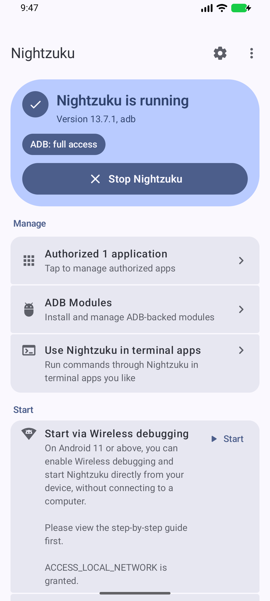
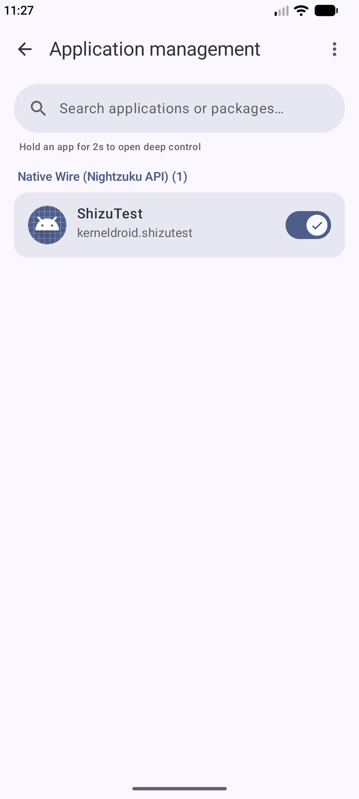
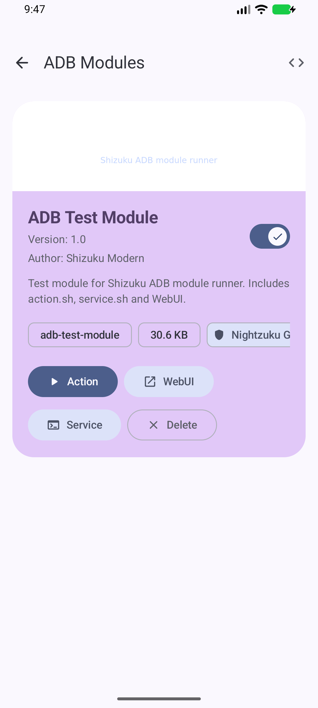
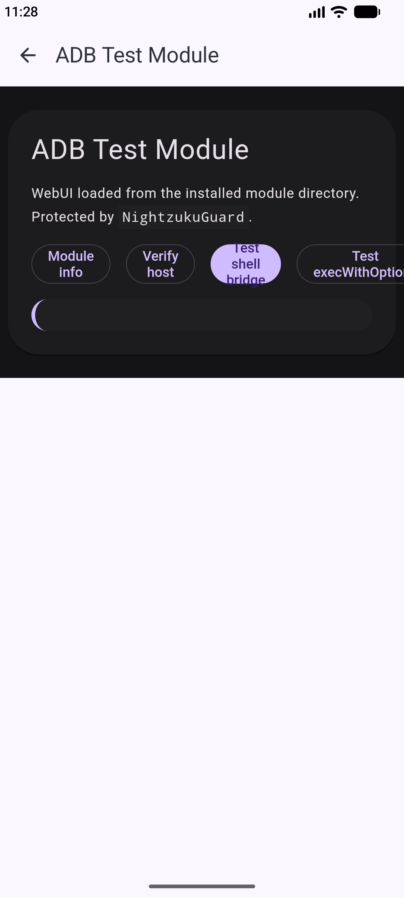
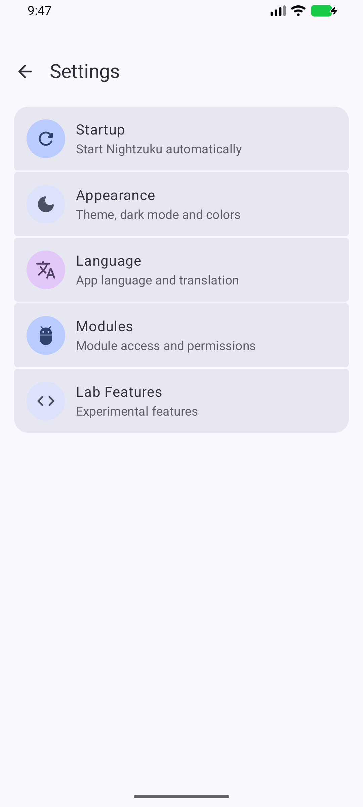
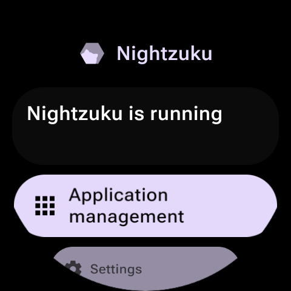
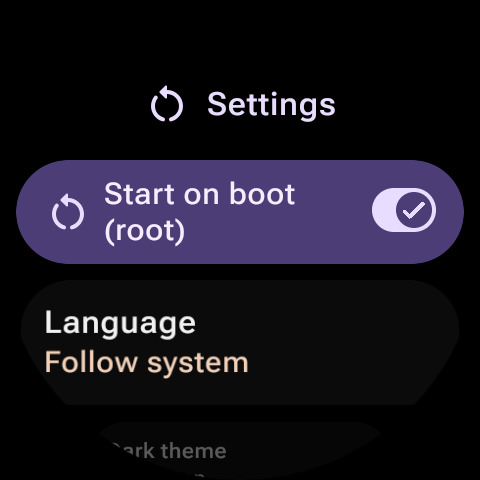
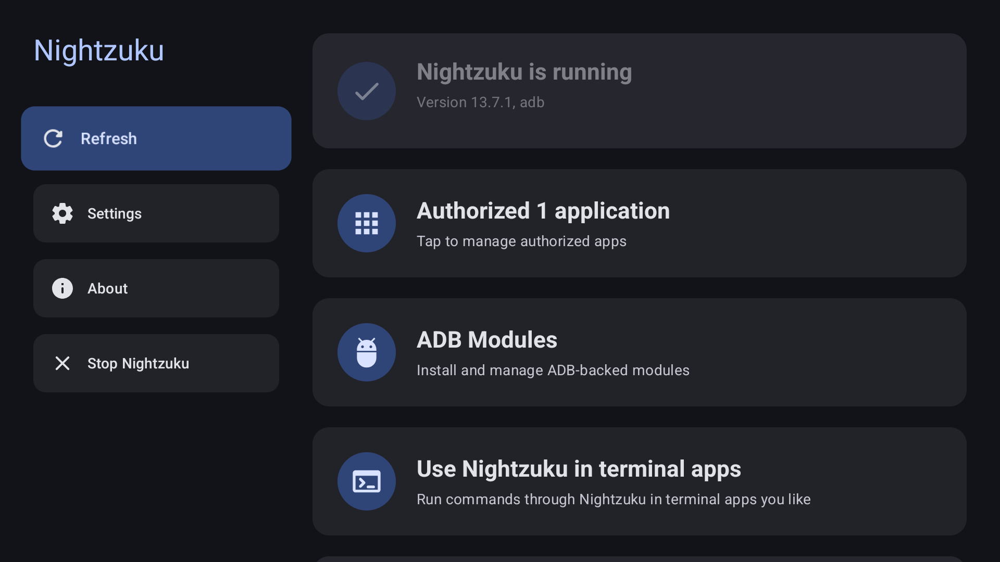
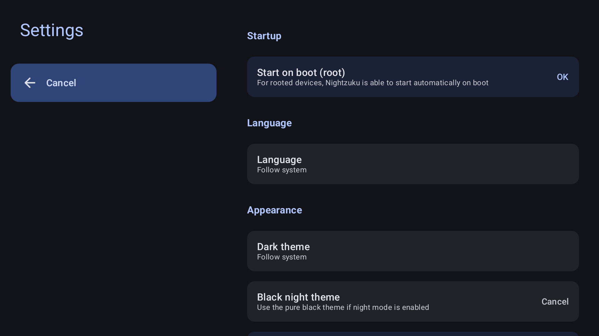

# Nightzuku

**Nightzuku** (`kerneldroid.nightzuku`) is an Android privileged Binder proxy and module execution runtime forked from [Shizuku](https://github.com/RikkaApps/Shizuku). It exposes Android system APIs directly to authorized client applications over Binder IPC under ADB (`uid=2000`) or root (`uid=0`) privileges, avoiding `su` shell spawning overhead.

> [!NOTE]
> Development is consolidated in this repository (`Nightzuku-private` is archived). Nightzuku strips `moe.shizuku.manager.permission.API_V23` from its merged manifest (`tools:node="remove"`) and can coexist with the official Shizuku manager without permission or authority conflicts.

## Architecture & Modules

| Module | Language | Responsibility |
| :--- | :--- | :--- |
| `:manager` | Kotlin / Jetpack Compose | Material 3 Expressive UI (Phone, Android TV, Wear OS), ADB pairing, Security & Access settings, ADB Modules manager, Smart Logs viewer |
| `:server` | Kotlin | Privileged `app_process` Binder server (`shizuku_server`), dual-wire IPC, signature pinning, user/profile isolation (`UserAccessPolicy`), `Android17Compat` |
| `:common` | Kotlin | Shared hidden-API introspector (`HiddenApiIntrospector`), package signature verifier, label sanitizer, `SmartLogEngine` |
| `:nightdog` | Kotlin | Server heartbeat watchdog (`NightDog`) and system service death/rebind supervisor |
| `rust/starter` | Rust | Native server supervisor (`libshizuku.so`), process respawn, and crash spooling |
| `rust/adb-pairing` | Rust | Native TLS / SPAKE2 / HKDF / AES-GCM wireless ADB pairing library (`libadb.so`) |
| `rust/rish` | Rust | Interactive remote shell client over Shizuku/Nightzuku Binder |

## Dual-Wire IPC Protocol

Nightzuku operates two concurrent Binder wires and routes each client package via `ClientRouting`:

| Wire | Interface / Permission | Characteristics |
| :--- | :--- | :--- |
| **Native** | `kerneldroid.nightzuku.INightService` (`kerneldroid.nightzuku.permission.API`) | Flat `Parcel` transactions, per-UID capability bitmasks, guarded `transactRemote`, one-shot `execFast`; zero server-side `moe.shizuku.api` stubs |
| **Legacy** | `moe.shizuku.server.IShizukuService` (`moe.shizuku.manager.permission.API_V23`) | Backward-compatible Shizuku Binder wire; can be disabled globally in **Settings -> Security & Access** |

`TransactGuard` validates target Binders and enforces per-UID capability masks before forwarding any `transactRemote` call.

## Security & Isolation Model

| Control | Mechanism | Default State |
| :--- | :--- | :--- |
| **Certificate pinning** | SHA-256 signing certificate verification with Android 9+ `signingCertificateHistory` rotation lineage across manager, clients, and `UserService` hosts | Always enforced |
| **Isolated profile protection** | `UserAccessPolicy` classifies and blocks Samsung Knox, Secure Folder (`100–199`), Dual Messenger (`95–96`), Android 15+ Private Space, and OEM Clone profiles (`128`, `999`) from enumeration, temp-whitelisting, and Binder dispatch | Enabled (blocked) |
| **Multi-user scope** | Configurable per-profile (Work Profile, Secondary Users) and per-user ID access via **Settings -> Security & Access** (`BINDER_TRANSACTION_getSecurityPolicy` / `setSecurityPolicy` / `getDeviceUsers`) | Primary user (`0`) only |
| **Binder delivery scope** | Selectable between all declared API clients and pre-authorized apps only (`binderDeliveryMode`) | All declared API apps |
| **Global access pause** | `accessPaused` immediately rejects non-manager Binder, shell, and `UserService` transactions | Off |
| **Permission dialog hardening** | `setHideOverlayWindows`, tap-grace delay, Unicode/Bidi label sanitization, shared-UID sibling disclosure, 5-minute prompt nonce window | Always enforced |
| **Smart Logs filtering** | Cross-layer crash/QPR/starter snapshot engine with strict OS/HWUI/OEM logcat noise filtering (`SmartLogEngine.filterProcessLogcat`) | Active |
| **Extended `app_process` cmdline** | `LargeCommandTransport` + `ArgvTrampoline` transparently lifts the 128 KiB Linux `MAX_ARG_STRLEN` limit up to `4 MiB` for `app_process` and `sh -c`; advertised via `getServerDiagnostics` (`maxAppProcessCmdlineBytes`, `supportsExtendedAppProcessCmdline`) | Active |

## Platform Support

| Platform | UI Stack | ADB Modules & Catalog | Security & Access |
| :--- | :--- | :--- | :--- |
| **Phone / Tablet** | Jetpack Compose Material 3 Expressive | Supported (local ZIP + GitHub Catalog + Virtual HTTPS WebUI) | Full UI in Settings |
| **Android TV** | `androidx.tv.material3` | Excluded | Server-enforced |
| **Wear OS** | `androidx.wear.compose:compose-material3` | Excluded | Server-enforced |

## Documentation

| Document | Scope |
| :--- | :--- |
| [ADB Modules API](docs/adb-modules-api.md) | ZIP format, `module.prop` schema, runtime env, `nightzuku-guard`, virtual HTTPS WebUI bridge |
| [ADB Modules Guide](docs/adb-modules-guide.md) | Authoring workflow, minimal module template, Action vs Service policy, safety limits |
| [GitHub Catalog](docs/github-catalog.md) | Decentralized `topic:adb-modules` discovery, PAT encryption, install modes, API quotas |
| [NightDog Architecture](docs/nightdog.md) | Server watchdog state machine, `NightDogClient` supervision, `JobScheduler` update checks |
| [Nightzuku Connectors](docs/nightzuku-connectors.md) | Local `ContentProvider` (`content://kerneldroid.nightzuku.connector`) for third-party activators |
| [Android 17 Compatibility](docs/android-17-compatibility.md) | Verified hidden API signatures (`IPermissionManager`, `IPackageManager`, `IUserManager`) and `Android17Compat` |
| [Android TV Support](docs/android-tv-support.md) | TV Compose architecture, D-pad focus model, and theming |
| [Wear OS Compatibility](docs/wearos-compatibility.md) | Runtime watch detection, Wear Material 3 components, and SDK compatibility |
| [Wear OS Pairing Guide](docs/wearos-pairing.md) | Wireless ADB pairing procedure and troubleshooting matrix for Wear OS 5+ |
| [ADB Loopback Restriction Memo](docs/adb-loopback-restriction-memo.md) | Why plain `adb tcpip` loopback startup is unreliable on Android 17+ |

## Developer & Build Reference

### Client Integration

- Upstream Shizuku API and samples: <https://github.com/RikkaApps/Shizuku-API>
- ADB shell capabilities vary by Android release; inspect AOSP `packages/Shell/AndroidManifest.xml` and query `ShizukuService#getUid` / `checkPermission` at runtime.
- Android 9+ restricts hidden API reflection; use [AndroidHiddenApiBypass](https://github.com/LSPosed/AndroidHiddenApiBypass) in client processes where required.
- Direct `transactRemote` callers must verify transaction codes and parameter layouts against the target platform's AIDL definitions.

### Building from Source

```sh
git clone --recurse-submodules https://github.com/kerneldroid/Nightzuku.git
cd Nightzuku
./gradlew :manager:assembleDebug
```

Run unit tests:

```sh
./gradlew :common:testDebugUnitTest :server:testDebugUnitTest
```

`:manager:assembleDebug` packages a debuggable server. Enable **Always install with package manager** in Android Studio to ensure updated server binaries are deployed.

## Screenshots

<details>
  <summary>Screenshot Gallery (automated emulator captures)</summary>
  <br/>

  > [!NOTE]
  > Captures are generated by [`.github/workflows/screenshots.yml`](.github/workflows/screenshots.yml) on Android 17, Wear OS 7, and Android TV 16 emulators and may lag behind `HEAD`.

  ### Phone
  <table>
    <tr>
      <td align="center"><br/><b>Main</b></td>
      <td align="center"><br/><b>Authorized Apps</b></td>
    </tr>
    <tr>
      <td align="center"><br/><b>ADB Modules</b></td>
      <td align="center"><br/><b>Module WebUI</b></td>
    </tr>
    <tr>
      <td colspan="2" align="center"><br/><b>Settings</b></td>
    </tr>
  </table>

  ### Wear OS
  <table>
    <tr>
      <td align="center"><br/><b>Main</b></td>
      <td align="center"><br/><b>Settings</b></td>
    </tr>
  </table>

  ### Android TV
  <table>
    <tr>
      <td colspan="2" align="center"><br/><b>Main</b></td>
    </tr>
    <tr>
      <td colspan="2" align="center"><br/><b>Settings</b></td>
    </tr>
  </table>
</details>

## License & Identity Constraints

Licensed under **Apache License 2.0** (`LICENSE`).

- **Launcher assets**: `manager/src/main/res/mipmap*/ic_launcher*.png` may only be used to represent Nightzuku.
- **Package identity**: The main app uses `kerneldroid.nightzuku`. Official releases also publish a compatibility stub under `moe.shizuku.privileged.api` and optional stealth-ID builds (`com.*`). Derived/unofficial works must not use the name `Shizuku` or that stub application ID.

## Credits

- [RikkaApps/Shizuku](https://github.com/RikkaApps/Shizuku) — upstream architecture and protocol.
- [Razgame](https://github.com/RazGame/Shizuku) — [app list fix](https://github.com/kerneldroid/Nightzuku/commit/6ea7e74984f860398760f5111a15083ea004c842).
- [Porter (d4rken-org)](https://github.com/d4rken-org/porter) — security hardening concepts (package signing verification, config ownership handoff, anti-spoofing permission prompts, wireless ADB/mDNS edge-case analysis), re-implemented natively for Nightzuku.
